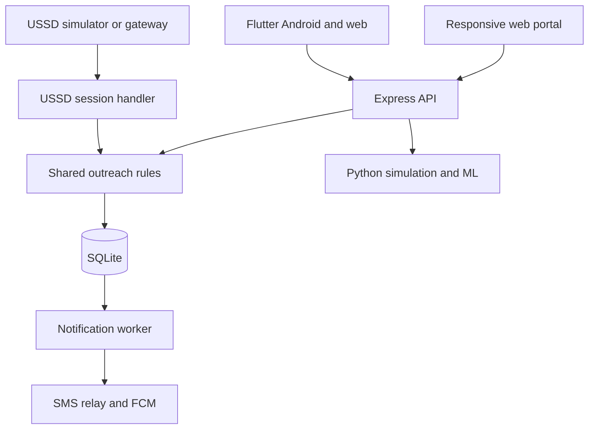
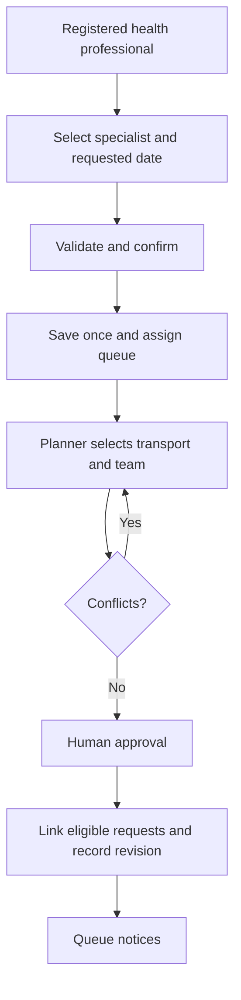

# Implementation and requirement traceability

## Functional requirements

| FR | Implemented behaviour | Main source |
|---|---|---|
| 1 | Specialist + requested date, reference, facility/specialty queue, approved date; registered-phone USSD; confirmation, TTL and idempotent submit | `server/src/outreach.js`, `server/src/ussd/outreach.js`, Flutter Requests |
| 2 | Atomic revision-linked in-app/SMS/push outbox; simulated or configured delivery; Flutter FCM token/foreground listener; web notices and browser notifications while portal is open | `server/src/notifications.js`, `flutter_app/lib/push.dart` |
| 3 | Eligible air/road legs, km/minutes, resource availability/range, airfield and road-edge restrictions, visible provenance | `compare()` in outreach module; Transport screens |
| 4 | Resource/team assignment, specialty/availability/overlap/travel checks; approval/change/cancellation; reason and optimistic version; audit | `conflicts()`, `saveVisit()`, Schedule screens |
| 5 | Six synthetic operational factors, reproducible seed, baseline + linear/tree/forest comparison, validation MAE, holdout MAE/RMSE/R², permutation ranking | `server/ml/simulate.py`, Simulation screens |

## Component architecture



## Request and scheduling flow



## Database tables

Schema is created idempotently in `server/src/outreach.js`; this is the executable schema source. Existing unrelated legacy tables are not destroyed when opening an old database, but are no longer exposed by active API routes. Start with a new database for a clean scenario.

| Table | Key / purpose |
|---|---|
| sm_users | UUID, unique username/phone, scrypt password, role, facility |
| sm_sessions | Bearer token, user, eight-hour expiry |
| sm_facilities | Location, coordinates, synthetic airfield flag |
| sm_resources | Air/road mode, assumed speed, range, available flag |
| sm_teams | Team, supported specialties, available flag |
| sm_roads | Origin/destination synthetic network edge, distance, speed, eligibility, provenance |
| sm_requests | UUID + monotonic sequence, user/facility/specialty, requested date, visit link, status; unique user + request key |
| sm_visits | Origin/destination, specialty, UTC reservation, resource/team, status, revision, reason |
| sm_notices | User + visit + revision + channel unique; message, attempts, delivery state |
| sm_devices | User and device token; registration reassigns a token to its current signed-in user |
| sm_audit | Actor, action, entity, before/after details and timestamp |
| sm_ussd | Phone-bound session, state, context, five-minute expiry, last step/result |

No patient histories, patient identifiers or diagnoses are collected. Queue numbers are derived at read time. Resource reservations include travel; adjacent non-overlapping reservations are allowed. There is no crew licensing, duty-hours, maintenance-calendar, weather-feed or flightworthiness validation.

## API (base `/api/v1`)

| Method/path | Access / behaviour |
|---|---|
| POST /login | Username/password → expiring bearer token and role |
| POST /logout | Revoke session and unregister user's push devices |
| GET /catalog | Signed-in catalogue |
| GET, POST /requests | Facility-scoped read and idempotent creation |
| GET /routes?origin=...&destination=... | Eligible leg estimates |
| GET /visits | Workers: own facility, no drafts; planners: all |
| POST /visits | Planner draft/approval |
| PUT /visits/:id | Planner revision with expected_revision; changes/cancellations need reason |
| POST /conflicts | Planner checks using the same rules as save |
| POST /resources/:id | Planner sets boolean available flag |
| GET /notifications | Own notices only |
| POST /devices | Register FCM device token |
| GET /audit | Planner audit access |
| POST /simulation | Planner; samples 200–5000, seed 0–2147483647 |

Example request payload:

```json
{"facility":"101","specialty":"Cardiology","preferred_date":"2026-12-10","request_key":"unique-client-submission-key"}
```

Schedule example (choose future times):

```json
{"facility":"101","origin":"lusaka","specialty":"Cardiology","start":"2026-12-10T08:00:00Z","end":"2026-12-10T16:00:00Z","resource":"air-1","team":"team-1","status":"approved"}
```

USSD callback is separate: `POST /api/ussd/ontech` with `SESSION_ID`, `MSISDN`, `REQUEST_TYPE` (1 start / 2 continue), `MESSAGE`, and a unique `STEP_ID` per input. Retries must retain the same step ID. Response uses `ussd_response.USSD_BODY` and `REQUEST_TYPE` (2 continue / 3 end). This adapter contract requires validation with the actual provider.

## Machine Learning sample modelling interpretationce

Target is a simulated efficiency score on 0–100, derived from synthetic delay relative to 240 planned minutes. Features: distance, weather severity, road condition, team availability, resource availability, pending requests. The generator formula is returned with each result and recorded in source. The sample output in `docs/synthetic_example.json` is illustrative, not observed service performan.

Permutation importance reports the increase in held-out MAE after shuffling each factor, with repeat standard deviation. The model winner is selected using validation MAE only. Features describe the synthetic scenario; none of this is evidence of real-world causation. No automatic dispatch or operational prioritisation is driven by the model.

## Limits before an operational pilot

Replace synthetic route/resource data; validate queue and request-linking policy; register actual professional accounts and provider phone mappings; review privacy/consent and retention; configure TLS and secrets; add backups, account recovery, provider status callbacks, managed FCM token refresh, approved team/crew rules and monitored deployment. Local SQLite supports a single-host prototype; multi-host operation needs a revised persistence strategy.
